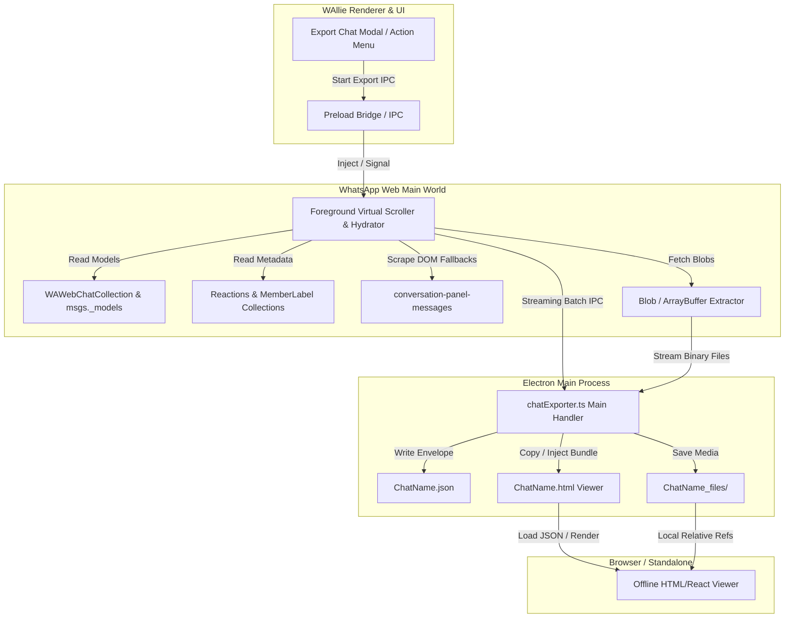

# WhatsApp Web Chat Export & Offline Viewer — Implementation Plan

This document details the complete architectural and engineering roadmap for **Point 4**: implementing the end-to-end Chat Exporter in WAllie and the standalone, pixel-perfect Chat Export Viewer.

---

## 1. Executive Summary & Goals

### High-Level Objectives
1. **Hybrid High-Fidelity Exporter**:
   - Combine direct in-memory WhatsApp model hydration (`ChatCollection`, `activeChat.msgs._models`, `WAWebMemberLabelCollection`, `WAWebReactionsCollection`) with foreground DOM scrolling to extract complete, authentic timelines.
   - Handle complex edge cases identified in live reverse-engineering: multi-click "Read more" buttons, phone on-demand peer sync (`HISTORY_SYNC_ON_DEMAND`), CDN 403 media expiry, polls, events, reactions, forwarded badges, `@mentions`, group member tags, and missed/completed call logs.
2. **Companion Assets Directory ("Save Complete Webpage" Pattern)**:
   - Output structured `<ChatName>.json` alongside companion directory `<ChatName>_files/` containing full-resolution images, videos, audio notes, documents, and cached avatars.
   - Support optional single-file portable JSON with embedded Base64 thumbnails for lightweight sharing.
3. **Standalone Pixel-Perfect Offline Viewer**:
   - Single-file zero-dependency HTML/React bundle (`<ChatName>.html`) that opens directly in any browser (Chrome, Firefox, Safari) offline.
   - Pixel-perfect replication of WhatsApp Web's conversation UI: grouped bubbles, tail SVGs, sender color indices, member tag subtitles, sticky date pills, scrubbable audio waveforms, quoted message jump-and-flash highlights, and interactive poll results.

---

## 2. Architecture & Data Flow

---

## 3. Work Breakdown & Phased Milestones

### Phase 1: Core Type Definitions & Main Process File Pipeline
- **Deliverables**:
  - `src/shared/chatExportTypes.ts`: Strongly typed TypeScript interfaces adhering strictly to [`docs/chat-export-spec.md`](docs/chat-export-spec.md).
  - `src/main/chatExporter.ts`: Electron main-process manager responsible for:
    - Target directory validation and folder creation (`<ChatName>_files/media/`, `<ChatName>_files/avatars/`).
    - Streamed / atomic JSON envelope assembly (`exportRange`, `completed: false` upon user abort).
    - Binary asset persistence: saving `ArrayBuffer` payloads to disk with deduplicated file naming based on stanza IDs.
    - Export progress and cancellation IPC endpoints.

### Phase 2: Injected Extraction Engine (Main World)
- **Deliverables**:
  - `src/preload/inject/chatExporter.ts`: Modular injection compiled into `dist/preload/index.cjs` via `scripts/build-preload.cjs`.
  - **Model & Metadata Hydration**:
    - Query `activeChat.msgs._models` to instantly retrieve message metadata, uncropped text bodies, poll option tallies, call logs, and base64 preview thumbnails.
    - Query `WAWebMemberLabelCollection` for custom group member tags.
    - Query `WAWebReactionsCollection` for aggregate emoji reactions and participant lists.
  - **Foreground Virtual Scroller**:
    - Smooth scrolling loop up `div[data-testid="conversation-panel-messages"]`.
    - Auto-detect phone sync button (`"Click here to get older messages from your phone"`).
    - Bounded DOM row detection and incremental accumulation into an in-memory `Map<string, MessageEntry>`.
  - **Binary Media Extractor**:
    - Detect `mediaStage === "RESOLVED"` and fetch same-origin `blob:` URLs directly into memory buffers.
    - Gracefully handle `mediaStage === "NEED_POKE"` / CDN HTTP 403 by falling back to high-res previews or marking media state as expired without stalling export traversal.

### Phase 3: WAllie UI Integration & User Flow

- **Settings Menu Entry**:
  - Add **"Chat Exporter"** as a top-level category in `SettingsModal.tsx` (`SETTINGS_MENU_ITEMS`):
    - Icon: `FileArchive` / `Share2`
    - Title: `"Chat Exporter"`
    - Description: `"Export chats to JSON, HTML, and launch the built-in offline viewer"`
- **Chat Exporter Settings Page (`src/renderer/components/settings/ChatExporterSettingsPage.tsx`)**:
  - **"Open Exported File" Action**:
    - File picker for `.json` or `.html` export files.
    - Launches the **Built-in Viewer in a new dedicated `BrowserWindow`** (completely decoupled from the settings modal and main WhatsApp view).
  - **"Export Currently Open Chat" Button**:
    - Instantly targets the active chat in the current account.
  - **Multi-Chat Selection Architecture**:
    - Retrieves available chats from the active account via preload (`activeChat`, `ChatCollection.getModelsArray()`).
    - Provides a searchable, checkable chat list with avatar, title, group/community indicator, and "Select All" / "Deselect All" options.
  - **Export Configuration & Calendar Prompt Modal**:
    - **Timeframe / Calendar Popup**:
      - Prompt for export duration boundary: "Export messages back to: [Date Picker / Calendar]" or "Entire available history".
      - Single unified calendar prompt applied to all selected chats.
    - **"Include Viewer" Checkbox**:
      - **Checked by default**.
      - Generates the standalone, pixel-perfect `.html` viewer alongside `<ChatName>.json` and `<ChatName>_files/`.
    - **Folder Picker**:
      - System dialog to choose target export directory.
- **Titlebar Integration ("Stop Export")**:
  - When an export starts, the Titlebar (`src/renderer/components/Titlebar.tsx`) dynamically renders an animated/prominent **"Stop Export"** button with status (e.g., `Stop Export • Chat 1/3 (42%)`).
  - Clicking this button immediately aborts the extraction traversal, finalizes the JSON envelope with `completed: false`, flushes pending assets, and restores the titlebar state without file corruption.

### Phase 4: Standalone Chat Export Viewer (`ChatName.html`)
- **Deliverables**:
  - Standalone single-page web app built with React / Tailwind CSS compiled into a self-contained HTML template (`src/viewer/`).
  - Bundled as an asset in WAllie and copied to the export destination as `<ChatName>.html`.
  - Features:
    - **Header**: Avatar, title, subtitle (group participants / community status), in-chat search input.
    - **Timeline Renderer**:
      - Grouped message bubble layout with authentic SVG tails (`tail-in` / `tail-out`).
      - Sender name colors + member tag subtitle.
      - Date divider pills (sticky or inline).
      - Status checkmarks (single grey, double grey, double blue).
      - Forwarded / Frequently Forwarded badges.
      - Interactive quoted replies: smooth auto-scroll to original message with temporary yellow highlight pulse.
      - Audio / Voice Note player with waveform preview and 1.5x / 2x speed toggle.
      - Image / Video lightbox modal.
      - Poll bubble with dynamic vote tally bars.
      - Missed / Answered call cards.
      - System notifications (e2ee, group joins/leaves).
    - **Responsive / Offline**: Works completely offline from local `file://` or local web servers.

### Phase 5: Verification & End-to-End Testing
- **Test Scenarios**:
  1. **Direct 1-on-1 Chat**: Text, voice notes, media blobs, and missed voice calls.
  2. **Group Chat with Member Tags**: Participant coloring, multi-member replies, reactions, and custom member labels.
  3. **Community Announcements**: Role badges (`Community admin`), pinned messages, and read-only styling.
  4. **Stress & Truncation Test**: Multi-chunk read-mores (Bee movie script), 10,000+ message scrolling, and mid-export cancellation.
  5. **Viewer Cross-Browser Check**: Chrome, Firefox, Safari compatibility on saved HTML.

---

## 4. Key Architectural Decisions & Safeguards

| Challenge | Safeguard / Solution |
| :--- | :--- |
| **Virtual DOM Row Pruning** | Never wait for scroll completion. Accumulate messages into a Map incrementally on every scroll step. Hydrate unmounted messages from `activeChat.msgs._models`. |
| **CDN HTTP 403 on Old Media** | Try same-origin `blob:` fetch first; if absent and CDN fails, fall back to base64 embedded preview in `msg.body` and set `mediaRef: null` with `unavailable: true`. Never block export on failed assets. |
| **Quoted Reply Jumping** | Viewer maintains an index of message IDs in the timeline. Clicking a quoted preview smoothly scrolls to the target element and applies a CSS flash animation. Out-of-bounds replies show a polite toast. |
| **Circular Structure Errors in IPC** | All IPC payloads between main world and preload pass through a clean serializer that strips React internals, DOM nodes, and non-scalar structures. |
| **User Abortability** | Every scroll step updates `exportRange.completed = false`. If the user cancels, the JSON envelope is finalized immediately, guaranteeing zero file corruption. |

---

## 5. Next Steps

With this implementation plan defined, we can proceed to **Phase 1** (Type definitions in `src/shared/chatExportTypes.ts` and main process handler setup in `src/main/chatExporter.ts`).

