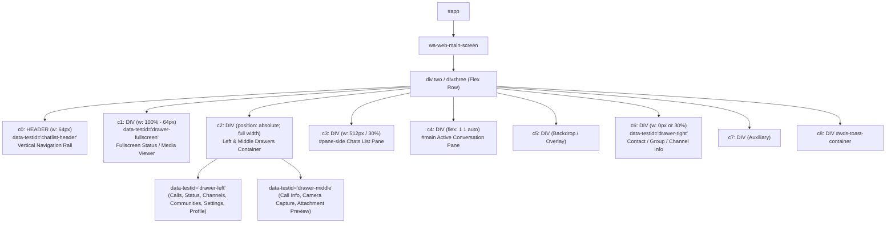
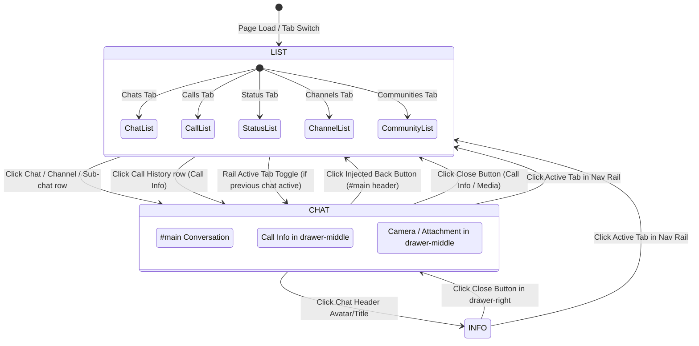

# WhatsApp Web Portrait Mode & Resolution-Constrained Responsive Layout — Technical Investigation

> **Context**: Generated during live Dev Bridge investigation (`scripts/wa-bridge.mjs` on `127.0.0.1:3888`) of WhatsApp Web's DOM layout, flex hierarchy, animations, drawer behavior, and modal structures under resolution constraints. This document details the exact DOM findings, why native resizing fails, and the DOM splicing & view transition architecture required to support portrait and narrow screen modes cleanly.

---

## 1. Executive Summary & Problem Definition

Desktop WhatsApp Web is engineered exclusively as a multi-pane horizontal layout with a hardcoded desktop breakpoint minimum width of **748px** (`.x1ljrdzs { min-width: 748px }`). On portrait displays, narrow windows, tiling window managers, or mobile/tablet foldables:
1. **Horizontal Clipping & Overflow**: WhatsApp Web flexes both the list pane (~340px) and the conversation pane (~340px) side-by-side, causing content to be squashed and cropped when the window width is under 748px.
2. **Layout Thrashing from CSS Width Animations**: When attempting to animate element widths (e.g. from 100% to 0%), WhatsApp Web's internal React `ResizeObserver` instances and layout managers recalculate the virtualized contact list (`#pane-side`) and message bubble heights on every animation frame. This produces severe stuttering, frame drops (dropping from 60fps to 10–15fps), and broken scroll positions.
3. **Three-Pane Conflict**: In standard desktop view, clicking a contact's header expands a third right-hand sidebar (`[data-testid="drawer-right"]`) for Contact/Group/Channel info. On narrow screens, showing 3 panes (or even 2) simultaneously is unusable.

### Core Objective
Implement a flawless **single-pane portrait mode** where:
- At any given time, **exactly one pane** is visible:
  1. **Left Sidebar / List View** (Chats list, Calls list, Status list, Channels list, Communities list).
  2. **Center / Main View** (Active Chat, Call Info, Camera modal, Attachment preview modal).
  3. **Right Sidebar / Info View** (Contact Info, Group Info, Channel Info, Starred messages in chat).
- Navigation rail stays pinned on the left (64px width).
- Clicking the active navigation rail tab toggles between the List view and the Chat view.
- For every page/tab change, the UI **must first start in List View**.
- Clicking any list item transitions smoothly into the Main/Chat view.
- In Chats, Channels, and Communities, a back button is injected before the avatar circle in `#main header` to return to the List view.
- In Calls, clicking a call history row opens Call Info (`drawer-middle`), which occupies the full width and has a native close button.
- In Status, clicking a status opens the fullscreen viewer (`drawer-fullscreen`), which already occupies the full viewport.
- Communities with nested sub-chats must be handled correctly: clicking a community expands its sub-chat list inside the sidebar (staying in List view), while clicking a specific sub-chat transitions to the Chat view.
- Camera and Attachment Preview modals (rendered inside `drawer-middle`) must occupy the full content width and return gracefully to the Chat view upon closing.
- Transitions must use **DOM splicing & GPU-accelerated transforms** rather than width resizing, preserving 60fps smoothness and preventing WhatsApp's virtualized list re-layouts.

---

## 2. WhatsApp Web DOM Hierarchy & Pane Map

All primary UI elements are housed under `[data-testid="wa-web-main-screen"] > div` (which switches between classes `.two` and `.three`).



### Detailed Child Pane Table

| Index | Element Selector | TestID / ID | Normal Desktop Role | Portrait Role |
| :--- | :--- | :--- | :--- | :--- |
| **0** | `HEADER` | `chatlist-header` | 64px navigation rail with icon buttons | Pinned at left (64px width) |
| **1** | `DIV` | `drawer-fullscreen` | Fullscreen drawer (Status viewer) | Fullscreen drawer (`left: 64px; width: calc(100% - 64px)`) |
| **2** | `DIV` | Contains `drawer-left` & `drawer-middle` | Absolute overlay container (`w: 100%`) | Houses Left Drawer (List view) and Middle Drawer (Call Info / Media / Camera) |
| **3** | `DIV` | Contains `#pane-side` | Chats list sidebar (width ~30% / 512px) | **List View** for Chats tab (`width: calc(100% - 64px)`) |
| **4** | `DIV` | Contains `#main` | Chat conversation pane (flex: 1 1 auto) | **Chat View** for Chats, Channels, Communities (`width: calc(100% - 64px)`) |
| **5** | `DIV` | — | Shading / backdrop container | Hidden or pass-through |
| **6** | `DIV` | `drawer-right` | Contact/Group/Channel info panel | **Info View** (`width: calc(100% - 64px)`) |

---

## 3. Deep-Dive Findings Per View & Tab

### 3.1 Navigation Rail (`c0`)
- Located at: `[data-testid="wa-web-main-screen"] > div > header`
- Width: Fixed at `64px`.
- Contains tab buttons with `aria-label`:
  - `"Chats"`, `"Calls"`, `"Status"`, `"Channels"`, `"Communities"`, `"Meta AI"`, `"Media"`, `"You"`
- **Active Tab Detection**:
  WhatsApp Web marks the active tab button using `aria-pressed="true"`. All other tab buttons have `aria-pressed="false"`.
- **Rail Toggle Behavior**:
  - Clicking a **different** tab switches to that section. Per requirement, the new section must **always initialize in List View**.
  - Clicking the **currently active** tab (`aria-pressed="true"`) functions as a view toggle:
    - If in Chat View or Info View -> switch to **List View**.
    - If in List View (and an active chat/history exists) -> switch to **Chat View**.

### 3.2 Chats Tab (`aria-label="Chats"`)
- **List View**: Rendered in `c3` (`#pane-side`). Each chat is a `[role="row"]` or `[data-testid^="list-item-"]`.
- **Chat View**: Rendered in `c4` (`#main`).
- **Back Button Placement**:
  - Header hierarchy: `#main header > div:first-child` contains:
    1. Child 0: `div[role="button"]` (Avatar display picture circle)
    2. Child 1: `div[role="button"]` (Chat title text & participant subtitle)
  - The Back button must be inserted **immediately before child 0** (the display picture circle).
  - Native SVG Arrow icon:
    ```html
    <svg viewBox="0 0 24 24" height="24" width="24" preserveAspectRatio="xMidYMid meet" fill="currentColor">
      <title>ic-arrow-back</title>
      <path fill="currentColor" d="m7.82 13 4.9 4.9c.2.2.3.43.3.7a1 1 0 0 1-.32.7c-.2.18-.43.28-.7.29a.92.92 0 0 1-.7-.29l-6.6-6.6a.88.88 0 0 1-.21-.32 1.1 1.1 0 0 1-.07-.38c0-.13.03-.26.07-.38a.88.88 0 0 1 .21-.32l6.6-6.6a.93.93 0 0 1 .69-.27.97.97 0 0 1 1.01.99c0 .27-.1.5-.3.7L7.82 11H19c.28 0 .52.1.71.29.2.19.29.43.29.71 0 .28-.1.52-.29.71A.94.94 0 0 1 19 13H7.82Z"></path>
    </svg>
    ```
  - Clicking the Back button switches the active portrait view from CHAT to LIST.

### 3.3 Calls Tab (`aria-label="Calls"`)
- **List View**: Rendered inside `c2 > div[data-testid="drawer-left"]`.
  - In desktop mode, `drawer-left` has `margin-left: 64px; width: 512px`.
  - In portrait mode, `drawer-left` must expand to `width: calc(100% - 64px)`.
- **Call Info View**: Rendered inside `c2 > div[data-testid="drawer-middle"]`.
  - When no item is selected, `drawer-middle` displays call options ("Start call", "New call link").
  - When a call history row is clicked, `drawer-middle` loads the Call Info page with:
    - `header`: Text "Call info"
    - `button[aria-label="Close"]`: Native close button at top-right
  - In portrait mode, `drawer-middle` must have `left: 64px; width: calc(100% - 64px);`.
  - Clicking the native `Close` button reverts `drawer-middle` and switches back to the Calls List view.

### 3.4 Status Tab (`aria-label="Status"`)
- **List View**: Rendered inside `c2 > div[data-testid="drawer-left"]`.
- **Status Viewer**: Rendered inside `c1 > div[data-testid="drawer-fullscreen"]`.
  - Already natively occupies the full viewport (`w: calc(100% - 64px)`).
  - Pressing Escape or clicking WhatsApp's close button closes `drawer-fullscreen` and returns to the Status list.

### 3.5 Channels Tab (`aria-label="Channels"`)
- **List View**: Rendered inside `c2 > div[data-testid="drawer-left"]`.
- **Channel Feed**: Rendered in `c4` (`#main`), identical in structure to a normal chat.
- Back button inserted before the channel avatar circle in `#main header` returns to the Channels List view.

### 3.6 Communities Tab (`aria-label="Communities"`)
- Communities feature a **2-level list hierarchy**:
  - **Level 1 (All Communities List)**: Shows all communities with top announcements/groups.
  - **Level 2 (Specific Community Detail)**: Clicking a community header navigates deeper into that community's sub-group listing inside `drawer-left`. WhatsApp Web natively provides a `button[aria-label="Back"]` inside `drawer-left`'s header to return to Level 1.
  - **Level 3 (Sub-Chat / Group Chat)**: Clicking any specific sub-chat row (e.g. "Announcements", "Debug Logs") opens `#main` (`c4`).
- **Splicing Behavior**:
  - Clicking a community header stays in **LIST view** (user is just navigating deeper into the list hierarchy).
  - Clicking an actual sub-chat transitions from **LIST view to CHAT view**.

### 3.7 Right Sidebar / Info Pane (`[data-testid="drawer-right"]`)
- Triggered by clicking the chat avatar or title in `#main header`.
- When opened:
  - Parent container toggles class from `.two` to `.three`.
  - WhatsApp plays CSS animation `@keyframes x1h4ohyg-B { 0% { flex-basis: 0%; } 100% { flex-basis: 30%; } }`.
  - WhatsApp squashes `c4` from 100% to ~60% and expands `drawer-right` to 30%.
- **Portrait Splicing Requirement**:
  - Only ONE pane visible! `drawer-right` must occupy `100%` of the content area (`calc(100% - 64px)`), while `c3` and `c4` are moved off-screen.
  - Override WhatsApp's `flex-basis: 30%` keyframe/style with `flex-basis: 100%` or full width.
  - Closing `drawer-right` (via its native `button[aria-label="Close"]`) smoothly returns to the Chat view.

### 3.8 Camera & Attachment Preview Modals
- Triggered via composer footer `button[aria-label="Attach"]` -> "Camera" or file selection.
- Both the Camera capture stream (`[data-testid="camera_capture_take_photo_btn"]`) and the Media Editor / Attachment Preview ("Retake", filters, stickers, caption bar, send button) are rendered inside:
  `c2 > div[data-testid="drawer-middle"]`
- In portrait mode:
  - `drawer-middle` must occupy `left: 64px; width: calc(100% - 64px);`.
  - Its native `button[aria-label="Close"]` closes the preview and returns to the Chat view.

---

## 4. Why Native Resizing Fails & The DOM Splicing Solution

### The Resize Failure
```
[User Window Resize / Width CSS Animation]
   │
   ▼
[Element Width changes: 500px -> 450px -> 400px ... frame by frame]
   │
   ▼
[WhatsApp ResizeObserver fires 60 times/sec]
   │
   ▼
[React re-computes virtual list item offsets & line wraps]
   │
   ▼
💥 Severe Jank (10-15 fps), Scroll Disconnect, Truncated Elements
```

### The DOM Splicing Architecture
Instead of animating `width` during pane transitions:
1. **Constant Sized Viewport Layers**: Every pane (`c3`, `c4`, `drawer-left`, `drawer-middle`, `drawer-right`) is given a constant width equal to the full content viewport (`calc(100vw - 64px)` or `calc(100% - 64px)`).
2. **GPU Compositor Transforms**: Transitions between List, Chat, and Info view are powered entirely via `transform: translate3d(...)` or staged sliding view wrappers with hardware acceleration.
3. WhatsApp's virtualizer sees an unchanging container width, completely bypassing expensive recalculations!

```mermaid
sequenceDiagram
    autonumber
    participant User as User
    participant State as Portrait View Controller
    participant Rail as Nav Rail (c0)
    participant List as List Pane (c3 / drawer-left)
    participant Chat as Chat Pane (c4 / drawer-middle)
    participant Info as Info Drawer (c6)

    Note over List,Info: Initial State: Portrait Mode, View = "LIST"
    List->>List: Visible (transform: translateX(0), w: 100%)
    Chat->>Chat: Off-screen (transform: translateX(100%))

    User->>List: Clicks Chat Row
    List->>State: Item Clicked Event
    State->>State: Set View = "CHAT"
    State->>List: Animate translateX(-100%) (GPU)
    State->>Chat: Animate translateX(0) (GPU)
    Note over List,Chat: Smooth 60fps Slide Transition, Zero DOM Width Reflow

    User->>Chat: Clicks Injected Back Button
    Chat->>State: Back Clicked
    State->>State: Set View = "LIST"
    State->>List: Animate translateX(0)
    State->>Chat: Animate translateX(100%)

    User->>Rail: Clicks Active Nav Tab
    Rail->>State: Active Tab Clicked (Toggle)
    State->>State: If CHAT -> switch to LIST; If LIST -> switch to CHAT
```

---

## 5. Architectural State Machine



---

## 6. Detailed DOM Selectors & Hook Points

### Injected Back Button
- **Container**: `#main header > div:first-child`
- **Insertion Index**: Prepend before first child (`div[role="button"]:first-child`)
- **Attributes**:
  - `class`: `walinux-portrait-back-btn`
  - `aria-label`: `"Back to chats"`
  - `role`: `"button"`
  - `tabindex`: `"0"`
- **Icon**: Native WhatsApp back arrow SVG `ic-arrow-back`.

### Navigation Rail Hook
- **Container**: `[data-testid="wa-web-main-screen"] > div > header`
- **Selector for Active Button**: `button[aria-pressed="true"]`
- **Click Interceptor**: Listen in capture phase on the rail:
  - If target button has `aria-pressed="true"`:
    - Prevent default WhatsApp re-click.
    - Toggle between `LIST` and `CHAT` state.
  - If target button has `aria-pressed="false"`:
    - User is switching tabs.
    - Reset state to `LIST` view immediately so the destination tab opens in List View!

### Communities Sub-Chat Detection
- List item selector: `[data-testid="cell-frame-title"]`
- Distinguish community header vs sub-chat:
  - Community headers in Level 1 navigate deeper inside `drawer-left` (shows "Announcements", "Groups you're in", and native Back button).
  - Sub-chats (or direct group chats) open `#main` (`c4`).
  - By monitoring `#main` header change / row click target, only trigger CHAT view transition when an actual chat row is selected.

### Right Drawer Animation Override
- Target: `div.two > [data-testid="drawer-right"]`, `div.three > [data-testid="drawer-right"]`
- WhatsApp keyframe override:
  - Ensure `flex-basis: 100%` when active in portrait mode.
  - Hide or translate `c3` and `c4` off-screen so only `drawer-right` is visible.

---

## 7. Next Steps & Implementation Roadmap

1. **Preload Inject Module**: Create `src/preload/inject/responsiveLayout.ts` containing the portrait detection, DOM splicing CSS injection, view state controller, back button injector, and nav rail click interceptor.
2. **Main World & Isolated World Coordination**: Register listeners via `whatsappMainWorld.ts` or preload isolated world to inject styles and handle click events.
3. **Settings & Auto-detection**: Support automatic portrait detection via `(max-width: 900px)` / aspect ratio, with seamless fallback when resizing between desktop and portrait view.
4. **Live Dev Bridge Verification**: Test each flow (Chats, Calls, Status, Channels, Communities, Info pane, Camera, Attachment preview, Nav rail toggle) on the live session.

